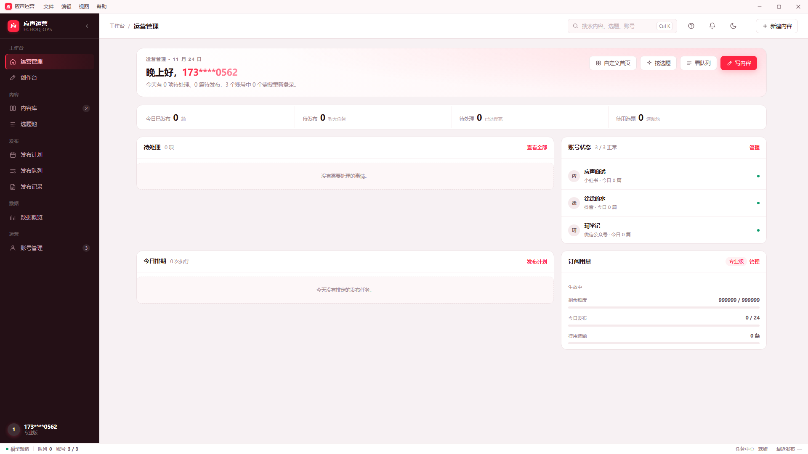
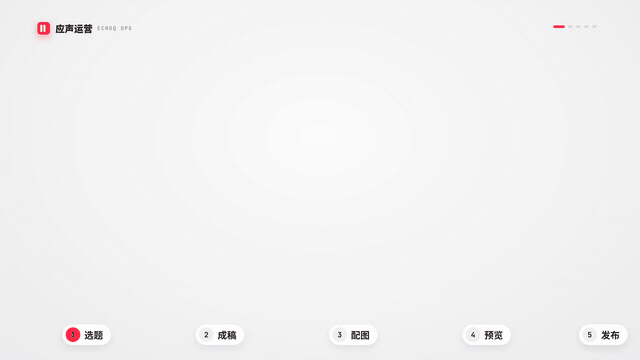
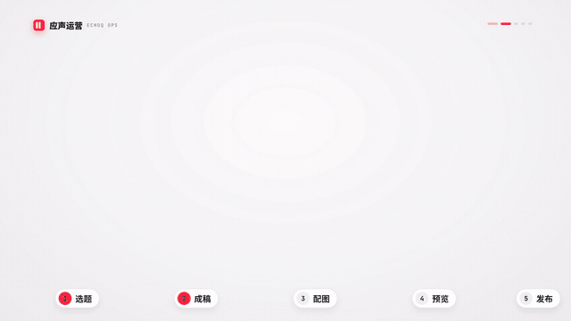
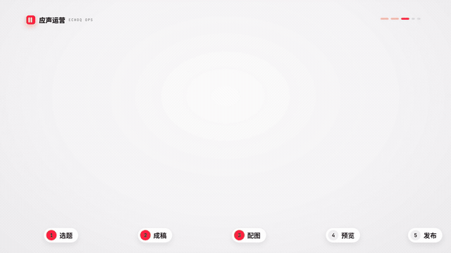
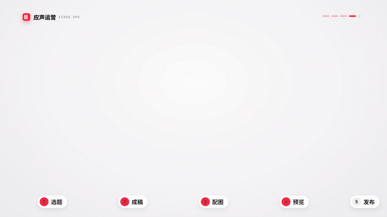

[简体中文](README.md) · [English](README.en.md)

<p align="center">
  
</p>

<h1 align="center">EchoQ Ops</h1>

<p align="center">Research, write, illustrate, preview, publish, and review — in one pipeline.</p>

<p align="center">
  <b>0.2.7</b> · Windows 10 / 11 (x64) · <a href="https://ops.echoq.cn/demo/">Interactive prototype</a> · <a href="https://github.com/xhmooc/echoq-ops/releases/tag/v0.2.7">Download 0.2.7</a>
</p>

<p align="center"></p>

> A Windows content operations workbench that runs locally. From topic to publish and back to review, everything happens in one window. It runs as a single process and listens on `127.0.0.1:8711` by default; accounts and the copy/image relay are provided by EchoQ. Intended for content creation and operations efficiency; make sure your use complies with each platform's rules and local laws.

## What's new

**0.2.7**

- **Three-platform images in one pass**: one draft renders Xiaohongshu 3:4, Douyin 9:16, and WeChat banner 2.35:1 + square 1:1 without cropping; target a single platform when you only need that set
- **Per-platform preview**: switching the preview platform shows only that platform's images in the phone preview and media grid, while publishing still ships all three sets
- **True multi-select publishing**: all three platforms selected by default, toggle as needed, and the account list follows the selection
- **Motion on demand**: the standalone "Generate 6s motion" button is back; the GIF lands first in the media list instead of being produced with every render
- **Safe-area checks**: Douyin's top 220 / bottom 520 text exclusion zones are validated, with layouts positioned proportionally
- **Title and hashtag limits**: titles compress by platform (10 / 12 / 14 characters), hashtags converge to 8 / 3 / 3
- **Preview cropping fixed**: the phone frame derives its height from the viewport and no longer overflows the preview column

## Features

### Operations dashboard: what needs doing today, at a glance

The home page summarizes today's published, pending, and queued notes plus unused topics, with account status and usage on the right. Expired logins, failed jobs, and a backlog all surface here — one click takes you to the page that fixes them.

<p align="center"></p>

### Topic pool: from keywords to writable topics

Mine topics by keyword, competitor account, channel, or on-site hot list, score and sort them, then turn the pick into a draft. Bulk import, pick from the question bank, or add one manually.

<p align="center"></p>

### Studio: write once, publish to several platforms

Pick the platform (Xiaohongshu / Douyin / WeChat Official Accounts), publishing account, and visibility on one page. The body switches between plain text and Markdown; WeChat drafts can apply multiple layout themes. The phone preview on the right updates as you type, mirroring title, body, hashtags, and images in the platform's own style. A built-in local model drafts from a brief, with selectable tone — and it keeps your writing habits.

<p align="center"></p>

### Illustrations 2.0: style × layout × palette

6 practical feed styles × 4 layouts × 3 palettes — 24 combinations, all rendered locally with HTML / CSS. Style cards carry sample previews so you can see the result before choosing; one request can produce 3 candidates with distinct styles and layouts, laid out side by side in the media preview area, and "Use" commits one as the official image. An appearance ledger records the styles used per account, down-weights recent ones, and forces a different style after two in a row, so consecutive posts do not look identical.

One run renders all three platforms: Xiaohongshu cover / content / closing pages, Douyin 9:16 portrait, and WeChat banner plus square. Every image carries a platform · purpose badge, and the media grid groups by platform.

<p align="center"></p>

### Hand-drawn illustrations: 5 media, reproducible by seed

Flat vector, pencil wash, marker comic, sumi-e ink, and paper-cut festival — randomness comes only from a seed: the same draft and composition render pixel-identically every time, and "Another composition" re-renders with a new seed. Supports 3:4 portrait (cover / content / closing pages) and 2.35:1 wide format for WeChat.

<p align="center"></p>

### Motion images: GIF and MP4

"Generate 6s motion" renders the current illustration frame by frame (6s × 25fps) and composites `loop.gif` and `motion.mp4` with ffmpeg; the GIF is placed first in the media list. If frame rendering or compositing fails, it falls back to the static first frame and records the reason on the job, so publishing never hangs.

### Preview: see it as it will look

The phone frame mirrors real device proportions, so title wrapping, cover cropping, and hashtag placement all match. Switch platform, switch images — no need to publish and delete to check.

<p align="center"></p>

### Publishing: queue, account rotation, and limits

Jobs run idempotently from a queue, with account rotation, daily limits and minimum intervals, failure classification with backoff, scheduled publishing, and one draft to multiple accounts. Expired logins are flagged and swapped automatically instead of stalling the queue.

<p align="center"></p>

### Review: published records and scheduled sync

Published notes are cached locally and can sync engagement data on a schedule. Failure details, retry counts, and reasons stay on each job, and scheduled task run history is visible on the page.

### Accounts: QR or cookie sign-in

Sign in by QR code or import cookies; credentials are encrypted locally. Account health is checked periodically, with automatic cooldown on risk control and a gradual ramp-up after recovery.

## Typical use

| Scenario | How |
| --- | --- |
| Daily topic selection and drafting | Mine topics in the topic pool, draft from a brief in the studio |
| Check the layout before publishing | Phone preview on the right, updated while you edit |
| Need illustrations | Pick built-in templates by sample preview; re-roll hand-drawn compositions |
| One draft, several platforms | Render three platform sets at once, preview per platform |
| Multiple accounts | Publish queue + account rotation + daily limits |
| Scheduled publishing | Scheduled tasks enqueue jobs at the chosen time |
| Review performance | Published records cached locally, engagement synced on a schedule |

## Quick start

1. **Download**: get the installer or portable build from [Releases](https://github.com/xhmooc/echoq-ops/releases/tag/v0.2.7). Windows 10 / 11 (x64)
2. **Sign in**: launch the app and sign in with your EchoQ account; drafts, images, and publish records stay on your machine
3. **Start**: pick a platform and topic, then go topic → write → illustrate → preview → publish → review

Direct links:

- Installer: https://dl.job.echoq.cn/echoq-ops-0.2.7-setup.exe
- Portable: https://dl.job.echoq.cn/echoq-ops-0.2.7-portable.exe

Want a look first? Open the [interactive prototype](https://ops.echoq.cn/demo/) — no install needed.

Run from source (Node.js 20+):

```powershell
cd desktop
npm install
npm run dev
```

## More

- **Compliance checks**: sensitive-word and platform-rule warnings while generating
- **Layout checks**: bounds, overlap, tiny type, and poor whitespace are checked before rendering — blocking what must be blocked, warning on the rest
- **Safe areas**: Douyin top / bottom text exclusion zones are validated; WeChat banner and square render as a pair
- **Visible failures**: failed jobs retry with backoff, and the reason stays on the job
- **Recoverable interruptions**: unfinished jobs are re-queued after a crash or exit instead of being dropped
- **Local storage**: credentials, drafts, images, and publish records stay on your machine

## Roadmap

**Hand-drawn illustrations**: more media (marker / highlighter, risograph, ink wash, woodcut, crayon and colored pencil), each with its own "mark-making" parameters rather than a palette swap; expand the subject library from 10 to 24, add two-subject relationships and three composition templates; handwritten titles that match each medium's stroke; later, bind style packs to accounts, keep a reusable illustration history, and illustrate sections by semantics.

**WeChat layout**: figure captions, quote cards, callout cards, tables of contents, step bars, and pull-quote blocks; inline code highlighting; a style-convergence check before pasting into WeChat; layout presets bound to accounts.

**Content and platform model**: a multi-platform version view of one draft (Xiaohongshu copy / WeChat long-form, convertible both ways), and a central platform capability matrix for title length, image count, and rich-text support.

## Troubleshooting

First check the installer version and system architecture (Windows x64). If that does not help, [open an issue](https://github.com/xhmooc/echoq-ops/issues/new) with the version, Windows version, and the exact error text — mask any account details in screenshots.

You can also join the feedback group: EchoQ Ops Group 1, **1136843749**.

## Build

```powershell
cd desktop
npm install
npm run dist
```

Output goes to `release\desktop\`.

## Project layout

```text
EchoQ-Ops/
├─ desktop/             current desktop app (Electron + Node, port 8711)
├─ ops/                 legacy aiohttp backend and web frontend
├─ vendor/              upstream Spider_XHS code: apis / xhs_utils / spider / upstream
├─ docs/                architecture, API, data model, runbook, changelog, and roadmap
├─ electron/            legacy desktop shell
├─ website/             marketing site source
└─ run.cmd              legacy entry point
```

More docs: [Architecture](docs/ARCHITECTURE.md) · [Runbook](docs/RUNBOOK.md) · [API](docs/API.md) · [Data model](docs/DATA_MODEL.md) · [Changelog](docs/CHANGELOG.md) · [Roadmap](docs/ROADMAP.md)

## License

[MIT](LICENSE). Product names, logos, and the EchoQ cloud services are not covered by this license.

`vendor/` comes from [cv-cat/Spider_XHS](https://github.com/cv-cat/Spider_XHS) under the MIT license; see [THIRD-PARTY-NOTICES.md](THIRD-PARTY-NOTICES.md).
