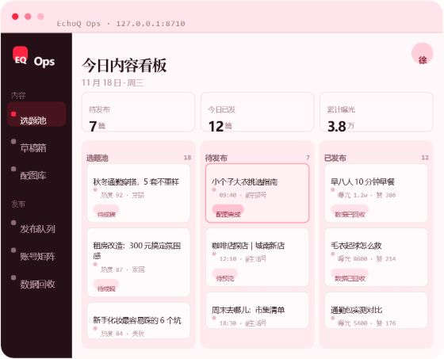

[简体中文](README.md) · [English](README.en.md)

<p align="center">
  
</p>

<h1 align="center">EchoQ Ops</h1>

<p align="center">Research, write, illustrate, preview, publish, and review — in one pipeline.</p>

> A Windows content operations workbench that runs locally. Go from a topic to a published note on one page, then come back to review what went out. It runs as a single process and listens on `127.0.0.1:8710` by default; accounts and the copy/image relay are provided by EchoQ. Intended for content creation and operations efficiency; make sure your use complies with each platform's rules and local laws.



## Features

### Content generation: a brief in, a draft out

Describe the topic, angle, and tone, and get a complete note. Multiple tones, topic suggestions, and live compliance checks are built in. If the model is unavailable, it falls back to an offline template instead of leaving a blank page.

### Phone preview: the note page, as the platform renders it

The right panel mirrors the platform's note detail view. Title, body, hashtags, and images update as you edit, so you do not have to publish and delete to check the layout.

### Illustrations: built-in templates and AI images

Built-in templates are rendered locally with HTML / CSS and captured headlessly — good for fixed layouts. When you need something new, generate an image with AI. Both paths check size, overlap, and bounds before writing the file, so text is not clipped.

### Publishing: queue, account rotation, and limits

Publishing jobs run idempotently from a queue, with account rotation, daily limits and minimum intervals, failure classification with backoff, scheduled publishing, and one draft to multiple accounts.

### Review: published notes and scheduled sync

Published notes are cached locally and can be synced on a schedule. Scheduled task run history is visible on the page.

### Accounts: cookie or QR sign-in

Import cookies or sign in by QR code; credentials are encrypted with Fernet and stored locally. Account health is checked periodically, with automatic cooldown when risk controls trigger.

## Typical use

| Scenario | How |
| --- | --- |
| Daily topic selection and drafting | Content generation — a brief in, a draft out |
| Check the layout before publishing | Phone preview on the right, updated while you edit |
| Need illustrations | Built-in templates for fixed layouts, AI images for new ones |
| Multiple accounts | Publish queue + account rotation + daily limits |
| Scheduled publishing | Scheduled tasks enqueue jobs at the chosen time |
| Review performance | Published cache and scheduled sync |

## Quick start

1. **Set up**: Windows 10 / 11, Python 3.10+, then install dependencies

   ```powershell
   python -m venv .venv
   .\.venv\Scripts\python.exe -m pip install -U pip
   .\.venv\Scripts\python.exe -m pip install -r requirements.txt
   .\.venv\Scripts\python.exe -m playwright install chromium
   ```

2. **Point at the cloud service**: copy `.env.example` to `.env` and adjust `OPS_CLOUD_BASE_URL` if needed. From source it defaults to `http://127.0.0.1:8787`; the packaged build points at `https://ops.echoq.cn`

3. **Start**:

   ```powershell
   .\.venv\Scripts\python.exe -X utf8 -m ops selfcheck
   run.cmd ops
   ```

   Open <http://127.0.0.1:8710> and sign in.

## More

- **Compliance checks**: sensitive-word and platform-rule warnings while generating
- **Visible failures**: failed jobs retry with backoff, and the reason stays on the job
- **Scheduled tasks**: jobs enter the queue on time, with run history
- **Local storage**: credentials, drafts, images, and publish records stay on your machine
- **Self-check**: `python -X utf8 -m ops selfcheck` verifies dependencies, folders, and config

## Troubleshooting

Run the self-check first to confirm dependencies and configuration. Check the console output if startup fails, and the job details if publishing fails. If that does not help, [open an issue](https://github.com/xhmooc/echoq-ops/issues/new) with the version, Windows version, and the exact error text — mask any account details in screenshots.

You can also join the feedback group: EchoQ Ops Group 1, **1136843749**.

## Build

The shipped form is an Electron desktop app:

```powershell
powershell -ExecutionPolicy Bypass -File build\build-desktop.ps1
```

Output goes to `release\electron\`.

## Project layout

```text
EchoQ-Ops/
├─ ops/                 aiohttp backend and web frontend (web/static)
├─ vendor/              upstream Spider_XHS code: apis / xhs_utils / spider / upstream
├─ docs/                architecture, API, data model, runbook, reviews
├─ build/               packaging scripts and PyInstaller config
├─ electron/            desktop shell (window + tray + local backend)
├─ website/             marketing site source
└─ run.cmd              single entry point
```

More docs: [Architecture](docs/ARCHITECTURE.md) · [Runbook](docs/RUNBOOK.md) · [API](docs/API.md) · [Data model](docs/DATA_MODEL.md)

## License

[MIT](LICENSE). Product names, logos, and the EchoQ cloud services are not covered by this license.

`vendor/` comes from [cv-cat/Spider_XHS](https://github.com/cv-cat/Spider_XHS) under the MIT license; see [THIRD-PARTY-NOTICES.md](THIRD-PARTY-NOTICES.md).
