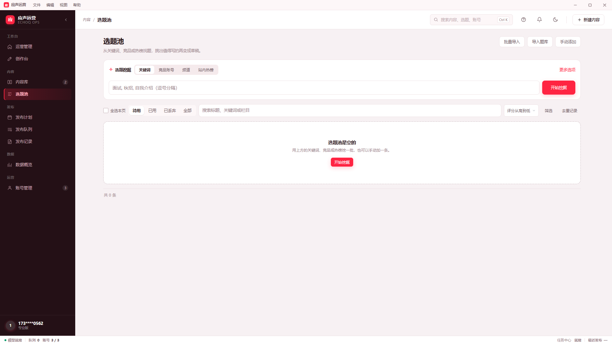
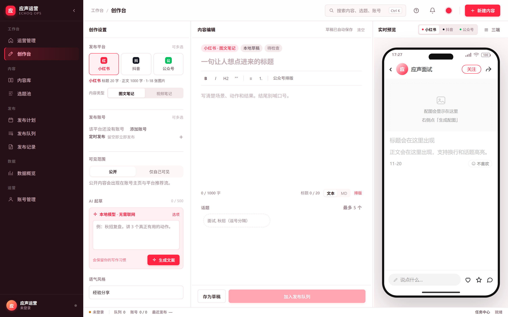
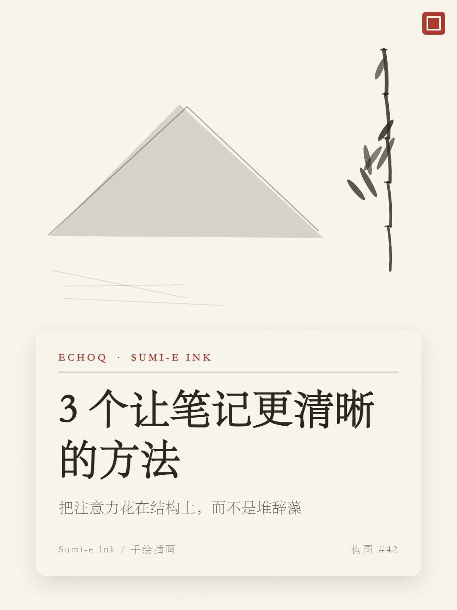

[简体中文](README.md) · [English](README.en.md)

<p align="center">
  
</p>

<h1 align="center">应声运营 · EchoQ Ops</h1>

<p align="center">选题、写稿、配图、预览、发布、回收，放在一条链路上。</p>

> 一个跑在本机的 Windows 内容运营工作台（Next 版，当前 0.2.5）。从选题到发布再到回收，都在一个窗口里完成。程序单进程运行，默认只监听 `127.0.0.1:8711`，账号、文案与配图中转由 EchoQ 提供。仅用于内容创作与运营效率提升，使用前请确认符合各平台规则与当地法律法规。


## 功能一览

### 运营管理：今天该做什么，一屏看完

首页汇总今日已发布、待发布、待处理和待用选题，右侧是账号状态与用量面板。账号掉线、任务失败、待办积压都在这页露出，点一下就到对应页面处理。

### 选题池：从关键词到可写的选题

按关键词、竞品账号、频道和站内热榜挖掘选题，评分后排序，挑中的直接转成草稿。也可以批量导入、从题库挑，或者手动加一条。



### 创作台：一处写完，多端可发

在同一页选择平台（小红书 / 抖音 / 微信公众号）、发布账号和可见范围。正文支持「文本 / Markdown」切换，公众号可套多套排版主题；右侧手机预览随编辑实时更新，标题、正文、话题和配图都按平台样式还原。内置本地模型起稿，可指定语气风格，也保留自己的写作习惯。



### 配图 2.0：风格 × 版式 × 调色板

6 套实用信息流风格 × 4 种版式 × 3 套调色板，共 24 种组合，全部在本机用 HTML / CSS 渲染。风格卡片带样张预览，选型前就能看到效果；一次可以出 3 套风格互异、版式互异的候选，直接占用预览区并排比较，点「选用」落定正式配图。外观账本记录每个账号用过的风格，近期用过的降权、连续两次同风格强制回避，避免连续出图撞脸。

### 手绘插画：5 种媒材，种子可复现

平涂向量、铅笔淡彩、马克漫画、水墨国风、剪纸节日五种手绘风格，随机只来自种子：同一草稿、同一构图，反复渲染逐像素一致；点「换一张构图」换种子重画。支持 3:4 竖版（封面 / 内容 / 结尾页）和公众号 2.35:1 宽幅。



### 动图：GIF 与 MP4

把配图动效逐帧渲染（6 秒 × 25fps），再用 ffmpeg 合成 `loop.gif` 和 `motion.mp4`。逐帧渲染或合成失败时自动回退静态首帧，并在任务里说明原因，不会卡住发布。

### 发布：队列、账号轮换与限额

发布任务进队列后幂等执行，支持多账号轮换、日限额与最小间隔、失败分类与退避重试、定时发布和一稿多号。账号登录失效会标记并换号，不用盯着队列手动重来。

### 回收：发布记录与定时同步

已发布内容在本地缓存，可定时同步互动数据；发布记录的失败现场、重试次数和原因都保留在任务详情里，计划任务的运行记录直接在页面上看。

### 账号：扫码 / Cookie 接入

支持扫码登录和 Cookie 导入，凭据在本机加密保存。定时巡检账号状态，遇到风控自动冷却，恢复后渐进放量。

## 适用场景

| 场景 | 用法 |
| --- | --- |
| 日常选题与写稿 | 选题池挖题，创作台一段需求直接出稿 |
| 发布前看排版 | 右侧手机预览，边改边看，不用发出去再删 |
| 需要配图 | 内置模板按风格样张选型，手绘插画可换构图 |
| 多账号运营 | 发布队列 + 账号轮换 + 日限额 |
| 定时发布 | 计划任务按时间进队列 |
| 发布后看数据 | 发布记录本地缓存，定时同步互动数据 |

## 快速开始

1. **下载安装**：从 [Releases](https://github.com/xhmooc/echoq-ops/releases) 下载安装版或免安装版，支持 Windows 10 / 11（x64）
2. **登录**：启动后登录 EchoQ 账号，草稿、配图与发布记录保存在本机
3. **开始使用**：选平台、写选题，按 写稿 → 配图 → 预览 → 发布 的顺序走

从源码运行（需要 Node.js 20+）：

```powershell
cd desktop
npm install
npm run dev
```

## 更多功能

- **合规检查**：生成时实时提示敏感词与平台规则风险
- **版式体检**：越界、重叠、字号过小、留白失衡在出图前检查，该拦的拦、该提示的提示
- **失败可见**：发布失败按类型退避重试，原因保留在任务详情里
- **中断可回收**：发布中断或程序退出后，未完成的任务会重新入队而不是丢单
- **本机存储**：账号凭据、草稿、配图和发布记录都保存在本机

## 后续计划

**手绘插画**：继续扩充媒材（马克笔 / 荧光笔、孔版 riso、水墨淡彩、木刻版画、蜡笔彩铅），每种媒材有独立的「做标记」参数，不只是换配色；主体库从 10 个扩到 24 个，加入双主体关系与三套构图模板；手写标题与媒材笔触一致；后续把风格包绑定到账号、支持插画历史复用与按小节语义配图。

**公众号排版**：补齐图注、引用卡、提示卡、目录、步骤条、金句块等标记语法；代码高亮产物直接内联；复制到公众号前做样式收敛检查；排版预设与账号绑定。

**内容与平台**：同一草稿的多平台版本视图（小红书文案 / 公众号长文互转），平台能力矩阵集中维护标题长度、图片张数与正文富文本支持。

## 遇到问题

先确认安装包版本与系统位数（Windows x64）。仍然解决不了，带上版本号、Windows 版本和报错原文[提 Issue](https://github.com/xhmooc/echoq-ops/issues/new)，截图里如果有账号信息记得打码。

也可以直接进反馈群：应声运营 1 群 **1136843749**。

## 打包

```powershell
cd desktop
npm install
npm run dist
```

产物输出到 `release\desktop\`。

## 项目结构

```text
EchoQ-Ops/
├─ desktop/             当前桌面版（Electron + Node，端口 8711）
├─ ops/                 旧版运营台后端（aiohttp）与前端
├─ vendor/              上游 Spider_XHS 代码：apis / xhs_utils / spider / upstream
├─ docs/                架构、接口、数据模型、运维、更新日志与路线图
├─ electron/            旧版桌面壳
├─ website/             官网静态页
└─ run.cmd              旧版统一入口
```

更多文档：[架构与数据流](docs/ARCHITECTURE.md) · [本地运行与配置](docs/RUNBOOK.md) · [接口文档](docs/API.md) · [数据模型](docs/DATA_MODEL.md) · [更新日志](docs/CHANGELOG.md) · [后续路线图](docs/ROADMAP.md)

## 许可协议

[MIT](LICENSE)。产品名称、Logo 与 EchoQ 云端服务不在授权范围内。

`vendor/` 来自 [cv-cat/Spider_XHS](https://github.com/cv-cat/Spider_XHS)，遵循 MIT，来源说明见 [THIRD-PARTY-NOTICES.md](THIRD-PARTY-NOTICES.md)。
