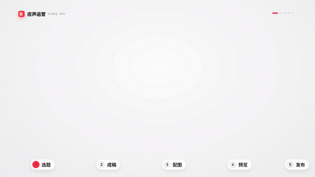
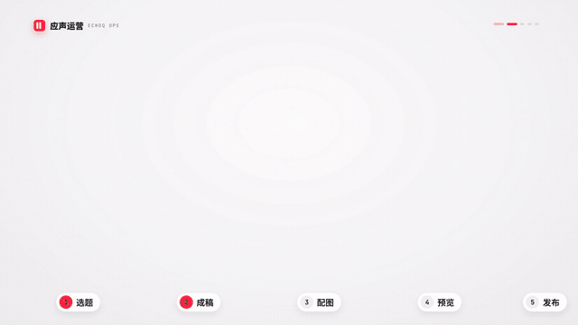
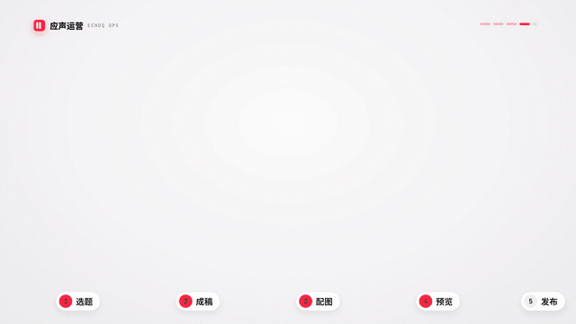
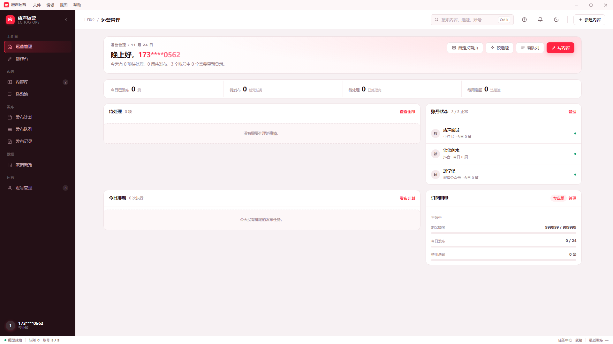

<p align="center">
  
</p>

<h1 align="center">应声运营 · EchoQ Ops</h1>

<p align="center"><b>全自动图文运营</b>：自己找选题、自己写、自己配图、自己排期、自己发。</p>

> 一个跑在本机的 Windows 图文运营工作台（当前 0.3.1）。配好账号和频率后，它每天自动完成「找选题 → 写稿 → 配图 → 出图/出视频 → 定时发布 → 回收数据」整条链路；你也可以随时接管，手动挑题、改稿、换图。程序单进程运行，默认只监听 `127.0.0.1:8711`，账号、草稿、配图、发布记录全部保存在本机。仅用于内容创作与运营效率提升，使用前请确认符合各平台规则与当地法律法规。


## 全自动是怎么跑的

一次配置，之后按天自动循环：

```text
定时触发
  └─ 找选题：关键词 / 竞品账号 / 频道 / 热榜（小红书、抖音、知乎、百度、头条）
      └─ 评分排序，挑出当天要写的题
          └─ 写成稿：按账号语气风格生成标题 + 正文 + 话题
              └─ 配图：风格 × 版式 × 调色板自动选型，按平台出图
                  └─ 排期：按计划时间进发布队列
                      └─ 发布：多账号轮换、日限额、失败退避重试
                          └─ 回收：发布记录与互动数据回到本地
```

中间任何一步都可以停下来人工改：选题池里换题、创作台里改稿、配图区换风格或换构图。全自动只是默认姿势，不是黑盒。

| ① 找选题 | ② 写成稿 | ③ 配图 | ④ 手机预览 | ⑤ 发布回收 |
| --- | --- | --- | --- | --- |
|  |  |  |  |  |

## 核心能力

### 自动选题

关键词、竞品账号、频道、站内热榜四个入口；新增抖音、知乎、百度、头条四个公开热榜来源。按互动、新鲜度、匹配度、新颖度四项打分排序，空池子会自动补题。


### 自动成稿

按平台和账号生成标题、正文、话题；支持指定栏目与语气，本地离线模板兜底，接上云端模型后可按账号写作习惯出稿。正文支持文本 / Markdown，公众号可套多套排版主题。


### 自动配图

- **实用信息流**：6 套风格 × 4 种版式 × 3 套调色板 = 24 种组合，本机 HTML/CSS 渲染
- **手绘插画**：平涂、铅笔淡彩、马克漫画、水墨国风、剪纸节日，随机只来自种子，同草稿可逐像素复现
- **一次三端出图**：小红书封面/内容/尾页、抖音 9:16 竖版、公众号横幅与方图
- **模板编辑器**：官方模板直接看真实出样图，双击转成可编辑版，保存为「我的模板」复用

| 手绘插画 |
| --- |
||

### 自动排版与动效

5 种动效范式（错峰入场、逐字浮现、缓推镜头、手绘生长、贴纸弹跳），可调时长与画幅；图组最多 10 张轮播成带字幕、带配乐的竖版 MP4；安装包内置 ffmpeg 与 3 条免版权配乐，不需要另装依赖。

### 自动发布

任务进队列后幂等执行：多账号轮换、日限额与最小间隔、失败分类与退避重试、定时发布、一稿多号。账号登录失效会标记并换号，程序退出后未完成任务重新入队而不是丢单。

### 自动回收

发布记录本地缓存，可定时同步互动数据；失败现场、重试次数和原因保留在任务详情里，计划任务运行记录直接在页面上看。数据概览按天、按平台统计发布量与趋势。



### 账号与通知

扫码登录 / Cookie 导入，凭据本机加密保存；定时巡检账号状态，遇风控自动冷却、恢复后渐进放量。待办、失败、掉线统一进通知中心。

## 适用场景

| 场景 | 用法 |
| --- | --- |
| 每天稳定更新 | 打开全自动，按计划自动出稿出图发布 |
| 只想要选题 | 选题池挖题，人工挑完再带入创作台 |
| 发布前看排版 | 右侧手机预览，边改边看，不用发出去再删 |
| 多账号矩阵 | 发布队列 + 账号轮换 + 日限额 |
| 手绘风内容 | 选一种媒材，换种子换构图 |
| 图文转视频 | 配图 + 字幕 + 配乐直接出竖版 MP4 |

## 快速开始

1. **下载安装**：从 [Releases](https://github.com/xhmooc/echoq-ops/releases/tag/v0.3.1) 下载安装版或免安装版，支持 Windows 10 / 11（x64）
2. **接入账号**：扫码登录或导入 Cookie，账号凭据加密保存在本机
3. **打开全自动**：选平台、设频率与发布时间，其余交给它跑

全新机器首次启动会自动建库，不再需要从旧版复制数据目录。

想先看界面，可以直接打开[在线体验原型](https://ops.echoq.cn/demo/)，不需要安装。

从源码运行（需要 Node.js 20+）：

```powershell
cd desktop
npm install
npm run dev
```

`ops/` 只保留前端资源 `ops/web/static`（桌面端界面），旧版 Python 运营台已移除。

## 这一版改了什么（0.3.1）

- **模板与真实出图一致**：官方模板直接用引擎出的样张做缩略图和预览；「用此页编辑」改为「真实插画底图 + 纸色面板 + 文字」，可编辑版和出图结果不再两张皮
- **模板编辑器**：官方模板按 封面 / 内容页 / 末页 分别取图，卡片与页型按钮不再出框
- **数据概览**：发布趋势修复为按平台分色堆叠（小红书红 / 抖音深灰 / 视频号绿），并修复图表宽度算成 0 导致一直空白的问题
- **选题池**：没有「原帖话题」的卡片，热度与栏目行不再上浮，同排卡片对齐
- **细节**：标题栏层级修正（文件/编辑菜单不再被顶栏盖住）、评分弹窗总分环居中、发布记录账号列不换行

## 开发与打包

```powershell
cd desktop
npm install
npm run dist
```

产物输出到 `release\desktop\`：`EchoQ-Ops-Next-Setup-<version>.exe`（安装版）与 `EchoQ-Ops-Next-Portable-<version>.exe`（免安装版）。版本号只改 `desktop/package.json`。

## 项目结构

```text
EchoQ-Ops/
├─ desktop/             桌面端主线（Electron + TypeScript，端口 8711）
│  ├─ src/main/         Electron 生命周期、窗口与 IPC
│  ├─ src/server/       本机 HTTP 与路由
│  ├─ src/services/     选题 / 草稿 / 文案 / 队列 / 定时 / 回收
│  ├─ src/render/       模板、手绘、自定义模板、动效、ffmpeg
│  ├─ src/platforms/    小红书 / 公众号 / 抖音适配器
│  └─ scripts/          ffmpeg 与内置配乐生成脚本
├─ ops/web/static/      桌面端界面（唯一前端资源）
├─ vendor/xhs_utils/    小红书签名（上游 Spider_XHS，MIT）
├─ docs/                架构、接口、数据模型、运维、更新日志与路线图
├─ website/             官网静态页与在线体验原型
├─ promo-video/         宣传片工程与渲染脚本
├─ build/               图标等打包资源
└─ release/             打包产物（不入库）
```

## 文档

- [架构与数据流](docs/ARCHITECTURE.md)
- [本地运行与配置](docs/RUNBOOK.md)
- [部署说明](docs/DEPLOY.md)
- [接口文档](docs/API.md)
- [数据模型](docs/DATA_MODEL.md)
- [多平台接入说明](docs/PLATFORMS.md)
- [抖音 / 公众号细节](docs/DOUYIN_WECHAT.md)
- [CHANGELOG](docs/CHANGELOG.md)
- [后续路线图](docs/ROADMAP.md)

## 边界与合规

- 本项目是内部运营工具，不绕过验证码；发布频率、账号风控与使用后果由使用者承担
- 本机接口无 Token 鉴权，只校验 Host / Origin / Referer；只应监听 `127.0.0.1`，不要直接暴露到公网
- 上游 `vendor/xhs_utils/` 来自 [cv-cat/Spider_XHS](https://github.com/cv-cat/Spider_XHS)，遵循其 MIT 许可

## 遇到问题

先确认安装包版本与系统位数（Windows x64）。仍然解决不了，带上版本号、Windows 版本和报错原文[提 Issue](https://github.com/xhmooc/echoq-ops/issues/new)，截图里如果有账号信息记得打码。

反馈群：应声运营 1 群 **1136843749**。

## 许可证

本项目采用 [PolyForm Noncommercial License 1.0.0](LICENSE)：允许个人学习、研究与自用，不允许商业使用；商业授权请联系作者。服务端与云端组件不在本仓库，也不在授权范围内。

第三方组件见 [THIRD-PARTY-NOTICES.md](THIRD-PARTY-NOTICES.md)。
